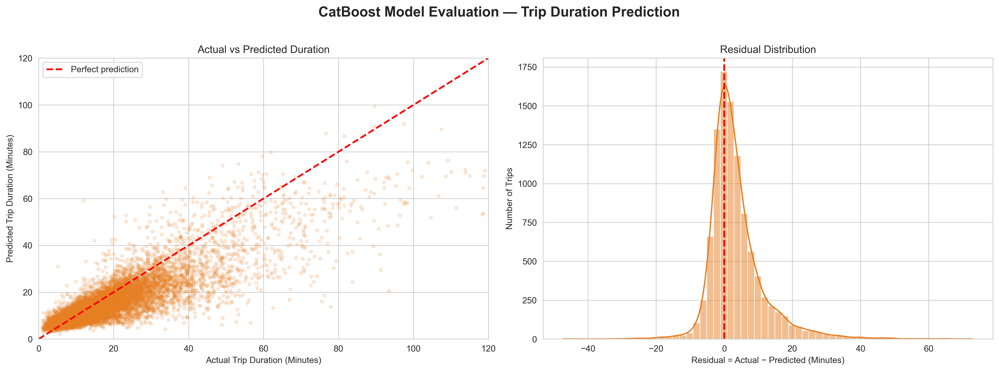
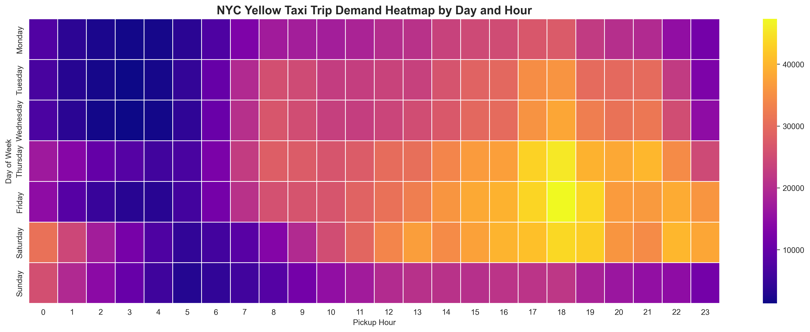

# 🚕 NYC Yellow Taxi: Mobility Intelligence & Trip Duration Benchmarking

[](https://www.python.org/)
[](https://streamlit.io/)
[](https://catboost.ai/)
[](https://www.docker.com/)
[](LICENSE)

An enterprise-grade Big Data analysis and predictive modeling platform processing over **3.72 million** NYC Yellow Taxi trip records from January 2026. The project spans Data Engineering, Exploratory Data Analysis (EDA), Geospatial GIS modeling, Machine Learning with strict anti-leakage feature hygiene, and a sub-second interactive Streamlit Dashboard.

---

## 📊 Analytical Highlights & Key Findings

* **Hyper-Concentrated Manhattan Monopoly:** Over **85.3%** of all yellow taxi trips originate and terminate within the same borough, heavily clustered around Midtown, Upper East Side, and major transport hubs (JFK Airport, Penn Station, Grand Central).
* **Speed & Congestion Dynamics:** Urban travel speeds exhibit severe time-of-day degradation: taxi velocity plummets by over **55%**, declining from **19.4 mph at 4:00 AM** (free-flow) to **8.5 mph at 3:00 PM** (mid-afternoon gridlock).
* **Tipping Dynamics & TLC Measurement Reality:** In the NYC Taxi & Limousine Commission (TLC) telemetry system, cash tips are systematically not captured by the meter (`tip_amount = 0` by default). Restricting evaluation to electronic credit card transactions ($N \approx 2.21\text{M}$), tipping percentages demonstrate statistically robust diurnal variation: reaching their nadir at **5:00 AM (~21.0% median tip)** before rebounding to **25.6%** during standard business hours.
* **Leakage-Free Predictive Modeling:** To predict trip duration without target or post-trip leakage, the model strictly excludes actual meter distance and fares. Instead, it utilizes projected geospatial centroids (**EPSG:2263**) to calculate pre-trip Euclidean proxy distances, evaluated against a future holdout split (January 25–31, 2026).

---

## 🔬 Machine Learning Benchmarking

All models were evaluated on an out-of-time future holdout set (January 25–31, 2026) to reflect real-world production deployment and prevent temporal information leakage.

| Model Candidate | MAE (min) | RMSE (min) | $R^2$ Score | Strategy & Architecture |
| :--- | :---: | :---: | :---: | :--- |
| **Median Dummy Baseline** | 11.23 | 14.85 | 0.000 | Naive central tendency heuristic |
| **Linear Regression** | 8.55 | 12.44 | 0.260 | Standard scaling + One-Hot Encoded borough/time |
| **Enhanced CatBoost Regressor** | **5.50** | **8.76** | **0.633** | Depth=8, L2-reg=7, projected centroid proxy distance |

<p align="center">
  <br>
  <em>Residuals and Actual vs. Predicted distributions on the out-of-time test partition.</em>
</p>

---

## 🚀 Streamlit Interactive Intelligence Platform

The interactive dashboard has been engineered with a sub-second query architecture:

1. **Geospatial Density Topography:** Mapbox dark-matter choropleth mapping all 265 taxi zones, with toggles between Pickup Origin and Dropoff Destination density plus borough filters.
2. **Behavioral & Traffic Dynamics:** Interactive Plotly telemetry covering hourly speed curves, demand heatmaps, and credit-card tipping psychology.
3. **AI Trip Duration & Congestion Simulator:** Live CatBoost inference with:
   * **Congestion Penalty Indicator:** Quantifies the delay penalty relative to 4:00 AM free-flow traffic.
   * **TLC Tariff Calculator:** Estimated fare breakdowns based on official NYC TLC tariff structures ($3.00 base, $0.70/fifth-mile, $2.50 congestion surcharge, peak hour surcharges).
4. **Model Governance & Integrity:** Transparent ablation tables and methodological audits.

<p align="center">
  <br>
  <em>Hourly trip demand density matrix by day of the week.</em>
</p>

---

## 📁 Repository Structure

```text
📂 data/                                      # Parquet dataset, zone lookup tables, and shapefiles
 ┣ 📜 yellow_tripdata_2026-01.parquet         # 3.72M raw trip records (Parquet)
 ┣ 📜 taxi_zone_lookup.csv                    # 265 NYC taxi zone mapping
 ┣ 📜 app_aggregates.json                     # Sub-second pre-aggregated telemetry cache
 ┗ 📂 taxi_zones/                             # Official NYC TLC shapefile polygons (WGS84 & EPSG:2263)
📂 img/                                       # High-resolution research figures
 ┣ 📂 EDA/                                    # Exploratory analysis visualizations
 ┣ 📂 ML/                                     # Machine learning residual & evaluation plots
 ┣ 📂 distribution/                           # Statistical distribution profiles
 ┗ 📂 geospatial/                             # Spatial choropleth renderings
📂 models/                                    # Serialized machine learning pipelines
 ┣ 📜 catboost_trip_duration.pkl              # Production CatBoost Regressor (37.7 MB)
 ┗ 📜 linear_regression_trip_duration.pkl     # Baseline Scikit-Learn Pipeline
📜 main.ipynb                                 # Top-to-bottom reproducible Jupyter Notebook
📜 app.py                                     # High-performance Streamlit Dashboard
📜 Dataset_explanation.md                     # Comprehensive bilingual schema definitions
📜 taxi_zone_exp.md                           # Taxi zone lookup documentation
📜 Dockerfile                                 # Container build specification
📜 docker-compose.yml                         # Container deployment orchestration
📜 requirements.txt                           # Frozen environment dependencies
📜 README.md                                  # Project documentation
```

---

## ⚡ How to Run

### Method 1: Local Python Environment
```bash
# 1. Install dependencies
pip install -r requirements.txt

# 2. Launch the Streamlit Intelligence Platform
streamlit run app.py
```

### Method 2: Docker Compose
```bash
docker-compose up --build
```
Navigate to `http://localhost:8505` in your browser.

---

## 📜 License
Distributed under the MIT License. See [LICENSE](LICENSE) for more information.
